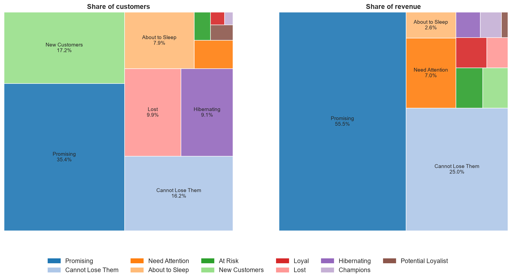
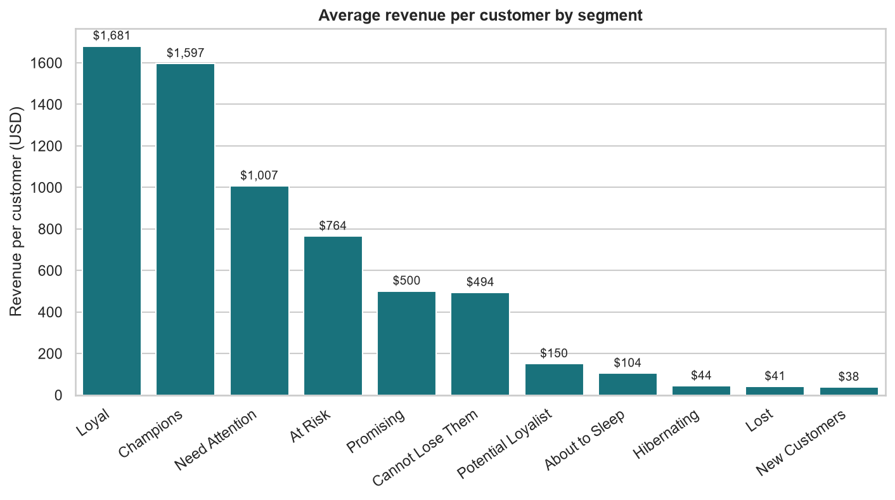

# RFM Customer Segmentation

[](https://github.com/Haven-Pham/rfm-customer-segmentation/actions/workflows/ci.yml)


## Overview

A CRM team sends the same campaigns to every customer. This project segments the 17,415 customers of a beauty and
home-care e-commerce retailer (51,290 order lines, 2020–2023) by Recency, Frequency and Monetary value. The goal is
to tell the team whom to reward, whom to develop and whom to win back.

**Summary of results.** Two segments hold 80.5% of revenue: *Promising* (35.4% of customers, 55.5% of revenue),
who bought recently and spent well, and *Cannot Lose Them* (16.2%, 25.0%), high spenders inactive for 2.7 years on
average. Repeat buying is rare: 88.7% of customers placed only one or two orders. Segments are therefore driven mainly
by recency and spend, and the biggest growth lever is earning a second and third order.



## Business Questions

1. Which customer segments generate the revenue?
2. Which segments are at risk of being lost?
3. What should the CRM team do differently for each segment?

## Approach

- **Monetary value** uses net revenue, `Sales × (1 − Discount)`.
- **Recency** is measured from a fixed snapshot date (2024-01-01, one day after the last order) for reproducibility.
- **Scoring.** R and M use quintiles. F has only nine distinct values with heavy ties, so its five bins are built on
  distinct order counts. Customers with the same number of orders always receive the same F score.
- **Segments.** RFM codes are mapped to eleven named segments using a standard RFM segment grid. Every customer is
  covered.

## Key Findings

| Segment | Customers | Revenue share | Revenue per customer | Avg. days since last order |
|---|---:|---:|---:|---:|
| Promising | 6,169 (35.4%) | 55.5% | $500 | 213 |
| Cannot Lose Them | 2,820 (16.2%) | 25.0% | $494 | 979 |
| Need Attention | 385 (2.2%) | 7.0% | $1,007 | 327 |
| Loyal | 62 (0.4%) | 1.9% | $1,681 | 275 |
| Champions | 37 (0.2%) | 1.1% | $1,597 | 90 |
| New Customers | 2,988 (17.2%) | 2.0% | $38 | 194 |

- **Promising customers are the growth engine.** They are recent, good spenders who have ordered only once or twice.
- **Cannot Lose Them is the main retention risk.** They are high spenders, but many bought only once. Win-back offers
  should be tested on a sample before a full roll-out.
- **Champions and Loyal customers are rare but worth about three times as much per head** as Promising customers.
- **Need Attention is small but valuable.** It has 2.2% of customers, 7% of revenue and the third-highest revenue
  per customer.



## Recommended Actions

| Segment | Objective | Actions |
|---|---|---|
| Champions, Loyal | Retain and reward | VIP tier, early access, referral programme |
| Potential Loyalist, Promising | Earn the next order | Personalised bundles, second-purchase incentive, loyalty enrolment |
| New Customers | Second purchase | Welcome series, onboarding offer |
| Need Attention | Stop the slide | Personal reminders, targeted offers |
| At Risk, Cannot Lose Them | Win back | Tested win-back offers; personal outreach for the highest spenders |
| Hibernating, Lost | Contain cost | Low-cost automated campaigns only |

## Repository Structure

```text
rfm-customer-segmentation/
├── data/                    EcomSales.csv and data dictionary
├── notebooks/               rfm_customer_segmentation.ipynb (analysis with outputs)
├── reports/
│   ├── figures/             score distributions, treemaps, revenue per customer
│   └── tables/              segment summary (CSV)
├── scripts/run_notebook.py  re-executes the notebook
└── requirements.txt
```

## Reproducing the Analysis

```bash
pip install -r requirements.txt
python scripts/run_notebook.py
```

## Data

Synthetic, educational e-commerce data; they do not describe a real company or real customers. Field definitions
are in [`data/README.md`](data/README.md).

## Limitations

- Because the data are synthetic, the findings illustrate the method.
- Low repeat purchasing compresses the F score, so the segment grid behaves mostly as an R × M grid.
- RFM describes past behaviour. Campaign response should be measured against control groups.

## Author

Pham Hong Hieu (Haven) · [Portfolio](https://haven-portfolio02.vercel.app) · [LinkedIn](https://www.linkedin.com/in/havenpham) · [GitHub](https://github.com/Haven-Pham)
